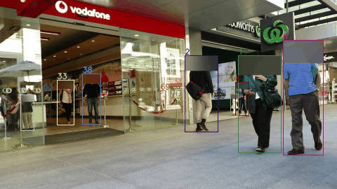

# object-tracking-bench

Detection + multi-object tracking measured with standard metrics, plus a per-track speed output. YOLO11 (n/s) person detector with Ultralytics' ByteTrack and BoT-SORT, run with PyTorch and with a TensorRT FP16 detector, scored with TrackEval (HOTA/MOTA/IDF1) on public MOT17 data.



*Low-resolution clip, person heads blurred.*

## Results

MOT17 train sequences 02, 04, 05, 09, 10 (~3.7k frames), person class, detector input 1280, conf 0.1. Raw numbers: `results/metrics.csv`, `results/metrics.json`, `results/timing.json`.

| Detector | Tracker | Backend | HOTA | MOTA | IDF1 | ID switches | FPS* |
|---|---|---|---|---|---|---|---|
| YOLO11n | ByteTrack | PyTorch | 41.24 | 42.96 | 48.71 | 828 | 27.2 |
| YOLO11n | ByteTrack | TensorRT FP16 | 41.36 | 42.47 | 48.26 | 823 | 30.3 |
| YOLO11n | BoT-SORT | PyTorch | 42.35 | 44.24 | 50.21 | 622 | 19.3 |
| YOLO11n | BoT-SORT | TensorRT FP16 | 42.43 | 43.86 | 49.84 | 652 | 21.1 |
| YOLO11s | ByteTrack | PyTorch | 43.39 | 45.19 | 50.98 | 751 | 20.2 |
| YOLO11s | ByteTrack | TensorRT FP16 | 44.53 | 45.34 | 52.03 | 831 | 22.9 |
| YOLO11s | BoT-SORT | PyTorch | 45.21 | 46.64 | 54.05 | 596 | 14.5 |
| YOLO11s | BoT-SORT | TensorRT FP16 | **45.47** | 46.63 | 53.33 | 652 | 17.4 |

\* End-to-end FPS (image read + detection + tracking) on an NVIDIA GB10 that was **shared with other heavy jobs** during the runs; treat FPS as relative, not absolute.

What the table says, plainly:
- **BoT-SORT beats ByteTrack on identity** (about 20–25% fewer ID switches, +1.5–3 IDF1) at a 24–30% speed cost, because of its camera-motion compensation and ReID-style matching.
- **YOLO11s over YOLO11n gains 2–3 HOTA** — on MOT17 the detector matters more than the tracker choice.
- **TensorRT FP16 keeps accuracy** (within ±1 HOTA) and gives a modest end-to-end speed-up here (+9–20%); at this input size the pipeline is not detector-bound only, so a 3x detector speed-up does not become 3x FPS.
- These are off-the-shelf trackers with default settings; no per-sequence tuning, no ReID model training.

**Not an official benchmark:** MOT17 *train* ground truth is used for scoring. Official MOT17 results come from the test-server; numbers here are comparable to each other, not to the leaderboard.

## Speed output

`speed.py` turns each track into a speed series in **pixels per second** (`results/speed_MOT17-*.csv`, summary in `results/speed_summary.json`, plot in `docs/speed_trajectories.png`). Pixel speed is not metric speed: converting to m/s needs a homography from the image to the ground plane (four known ground points, e.g. pitch or lane markings) or a calibrated camera with known height. That step is described here as the approach; it is not demonstrated on MOT17 because the sequences have no ground-plane reference.

## How I would adapt this to sports footage (approach, not measured here)

- Fine-tune the detector on a few hundred labelled frames from the actual broadcast/camera (small, fast players and occlusions differ from pedestrians).
- Use BoT-SORT with camera-motion compensation for panning broadcast cameras; add a team-colour or jersey-number cue to reduce ID switches.
- Estimate the pitch homography per frame (keypoints on line markings) to get metres, speed and distance covered per player.
- Validate on a labelled clip with the same TrackEval metrics before trusting the stats.

## Reproduce

```bash
python prepare_data.py     # downloads MOT17 (train) and TrackEval
python track.py            # YOLO11n/s × ByteTrack/BoT-SORT × PyTorch/TensorRT → results/tracks/
python evaluate.py         # TrackEval HOTA/MOTA/IDF1 → results/metrics.csv|json
python speed.py            # per-track px/s → results/speed_*.csv
python demo.py             # small blurred GIF → docs/demo.gif
pytest -q tests
```

Run heavy steps one at a time on a shared machine (e.g. `nice -n 19`, `OMP_NUM_THREADS=4`).

## License

Code: MIT. Author: Ha Phan Thanh Hai.
Data: MOT17 (motchallenge.net) is licensed CC BY-NC-SA 3.0 — the demo clip and metrics derived from it are for non-commercial demonstration.
